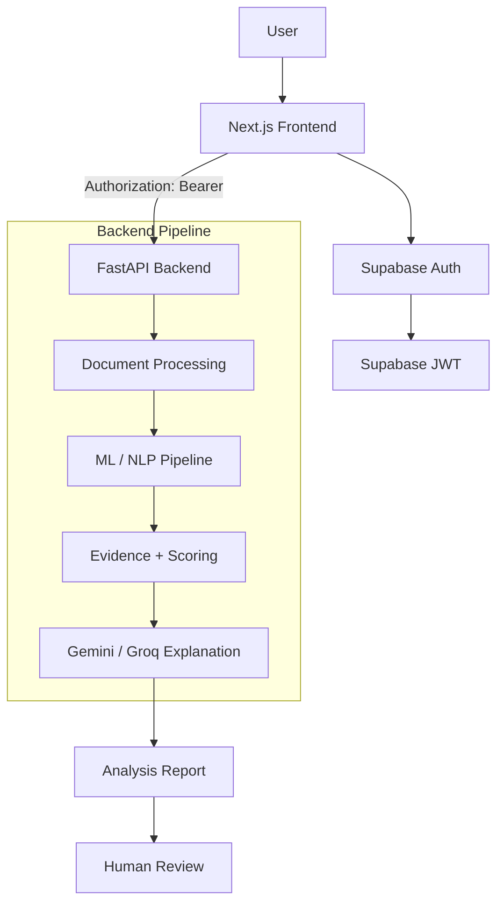

# Proofly

An academic-integrity analysis platform designed to provide explainable signals and evidence to assist human review of student submissions.

## Core Capabilities
- **Document upload:** Supports TXT, PDF, and DOCX formats.
- **AI-associated writing signals:** Analyzes structural and linguistic patterns that may indicate AI generation. 
- **Source similarity:** Matches submitted text against provided reference sources.
- **Paraphrase/similarity analysis:** Evaluates potential paraphrasing from known materials.
- **Writing fingerprint:** Compares documents against baseline stylistic features.
- **Evidence generation:** Scores findings and aggregates them into a comprehensive risk profile.
- **Explainable analysis:** Utilizes LLMs (Gemini / Groq) to summarize findings in plain, cautious language.
- **Confidence/uncertainty levels:** Clearly displays algorithmic confidence where available.
- **Role-based access:** Supabase authentication strictly enforcing `instructor` and `student` operational bounds.

*Note: Proofly detects AI-associated writing signals to assist human academic review. It does not guarantee perfect detection and cannot determine authorship or AI-generation with absolute certainty.*

## Technology Stack

- **Frontend**: Next.js, TypeScript, Tailwind CSS
- **Backend**: Python, FastAPI
- **Authentication**: Supabase Auth (JWT)
- **Database**: Supabase / PostgreSQL
- **ML/NLP**: spaCy, textstat, scikit-learn, existing ML pipeline
- **LLM**: Gemini (default), Groq/Llama (optional)
- **Document parsing**: Custom extraction for TXT, PDF, and DOCX formats

## Architecture Overview


*The backend remains the authoritative source of truth for all analysis and authorization logic.*

## Project Structure

```
academic-integrity/
├── backend/       # FastAPI server and API routes
├── frontend/      # Next.js React application
├── ml/            # Machine learning, NLP, and orchestration pipelines
├── tests/         # Comprehensive pytest suite
├── docs/          # Supplemental project documentation
├── scripts/       # Demo and evaluation tools
├── .env.example   # Template for required environment variables
├── README.md      # This file
├── DEPLOYMENT.md  # Production deployment guide
└── PROGRESS.md    # Project phase tracking and logs
```

## Local Setup

### 1. Backend Setup

```bash
cd academic-integrity

# Create and activate virtual environment (Windows)
python -m venv .venv
.venv\Scripts\activate

# Install requirements
pip install -r backend/requirements.txt

# Run the server
uvicorn backend.main:app --reload --port 8000
```
- **Health Check**: `http://127.0.0.1:8000/api/health`
- **Swagger Documentation**: `http://127.0.0.1:8000/docs`

### 2. Frontend Setup

```bash
cd frontend
npm install
npm run dev
```
- **Frontend Dashboard**: `http://localhost:3000`

## Environment Variables

**Backend Variables (`.env` in root directory):**
- `SUPABASE_URL`: Your Supabase Project URL
- `SUPABASE_KEY`: Supabase Service Role Key (backend only)
- `SUPABASE_JWT_SECRET`: JWT Secret used to decode tokens
- `GEMINI_API_KEY`: API Key for Google Gemini
- `CORS_ORIGINS`: Allowed frontend origins (default: `http://localhost:3000`)

**Optional LLM Variables (Backend):**
- `LLM_PROVIDER`: `gemini` (default) or `groq`
- `GROQ_API_KEY`: Required if provider is set to groq
- `GROQ_MODEL`: Specific model to run (e.g., `llama-3.3-70b-versatile`)

**Frontend Variables (`frontend/.env.local`):**
- `NEXT_PUBLIC_SUPABASE_URL`: Your Supabase Project URL
- `NEXT_PUBLIC_SUPABASE_PUBLISHABLE_KEY`: Supabase Anon Key
- `NEXT_PUBLIC_API_URL`: Backend URL (e.g., `http://127.0.0.1:8000`)

**SECURITY WARNING**: Never put backend secrets (`SUPABASE_KEY`, `SUPABASE_JWT_SECRET`, `GEMINI_API_KEY`, `GROQ_API_KEY`) into the frontend `.env.local` file. `.env.example` contains placeholders only.

## Authentication
The application relies on a strict Supabase JWT verification architecture:
1. Frontend authenticates directly via **Supabase Auth**.
2. Frontend retrieves the active session and injects the `Authorization: Bearer <token>` header.
3. The FastAPI backend decodes the token using `SUPABASE_JWT_SECRET` and enforces role-based constraints.

*Note: The backend does not provide a traditional `/login` endpoint. Supabase email confirmation is respected. Mock authentication is strictly disabled in production.*

## API Documentation

- `GET /api/health` - Validates that the server is actively running.
- `POST /api/analysis/run` - The core orchestrator pipeline. Accepts `multipart/form-data` containing `file` (UploadFile), `student_id` (str), and `assignment_name` (str). Triggers the full pipeline and returns the `OrchestratorResult`.

*(View `http://127.0.0.1:8000/docs` for the complete, interactive OpenAPI schema of all supporting analysis endpoints.)*

## Analysis Pipeline

1. **Document Ingestion**: Securely streams the file.
2. **Text Extraction**: Converts TXT, PDF, and DOCX natively.
3. **Feature Extraction**: Calculates statistical NLP baselines.
4. **AI-Associated Writing Signals**: Analyzes text against LLM-style artifacts.
5. **Embeddings**: Utilizes Gemini to project the text structurally.
6. **Source Similarity**: Compares embeddings against known references.
7. **Paraphrase Analysis**: Identifies rewritten sections from matched sources.
8. **Writing Fingerprint**: Evaluates stylistic deviation from student baselines.
9. **Evidence**: Aggregates the findings into discrete evidence objects.
10. **Scoring/Risk**: Generates a unified risk score (0-100) and confidence interval.
11. **LLM Explanation**: Gemini (or Groq) summarizes the mathematical evidence engine outputs into human-readable text.

## Gemini / Groq

- **Gemini** is the system's default LLM provider.
- **Groq / Llama** can be used by setting `LLM_PROVIDER=groq`. 
- **Important**: Text embeddings will universally continue to use the Gemini embedding pipeline regardless of the `LLM_PROVIDER` toggle. Groq currently operates strictly as an optional explanation/report-generation provider.

## Testing

The backend suite tests data models, JWT mocks, extraction, and orchestrator pipelines.
```bash
# Run 56 passing backend tests
pytest tests/
```

The frontend static build strictly verifies TypeScript typings and layout generation.
```bash
# Run static compilation
cd frontend
npm run build
```

*Note: Fully authenticated UI integration flows are restricted by Supabase email confirmation prerequisites if local mail servers or Supabase console access is unavailable.*

## Security

Proofly implements standard security practices:
- Secrets are restricted strictly to environment variables.
- The frontend client utilizes purely safe publishable keys.
- `Service-role`, `JWT`, `Gemini`, and `Groq` keys remain fully confined to the backend process.
- FastAPI mandates valid JWT structures and role boundaries for API interaction.
- Strict CORS rules block unauthorized domains.
- File uploads are validated (10MB limits, strict MIME parsing) and processed via in-memory buffers avoiding arbitrary filesystem writes.
- Next.js statically injects standard Security Headers (`X-Frame-Options`, `X-Content-Type-Options`).
- Error stacks are sanitized prior to UI transmission.

*(A minor development `npm audit` warning exists regarding `braces` inside the `eslint-config-next` dev-dependency. This strictly affects local dev-server routing and introduces no runtime web exploits.)*

## Limitations

- Academic-integrity analysis is **probabilistic** and highly **assistive**.
- AI-associated signals should **never** be treated as definitive proof.
- **Human review remains fundamentally necessary** for all academic determinations.
- The platform relies heavily on configured external LLMs (Gemini) to perform its core pipeline logic.
- Supabase email confirmation demands verified mail protocols, potentially blocking initial user creation if misconfigured.

## Contribution / Maintenance

1. Create a feature branch.
2. Implement your changes.
3. Run the backend tests (`pytest tests/`).
4. Run the frontend compilation (`npm run build`).
5. Ensure no secrets are inadvertently staged.
6. Update relevant documentation.
7. Commit and submit a PR.
